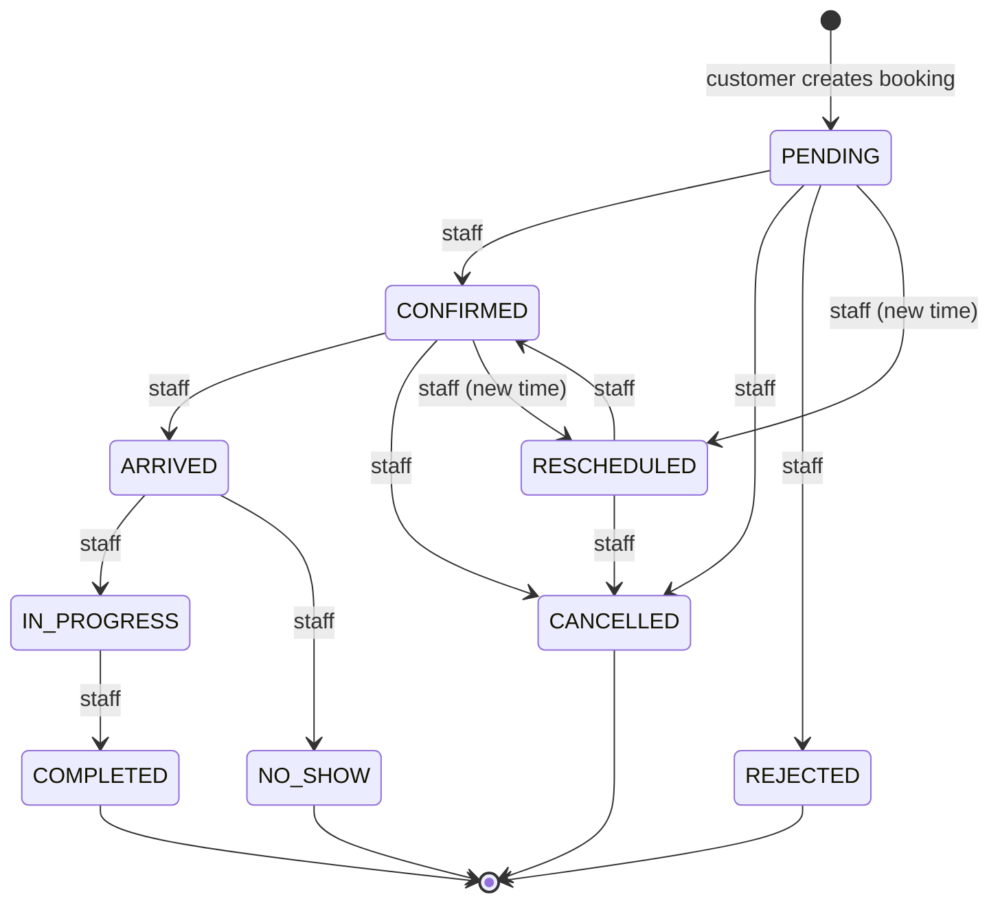
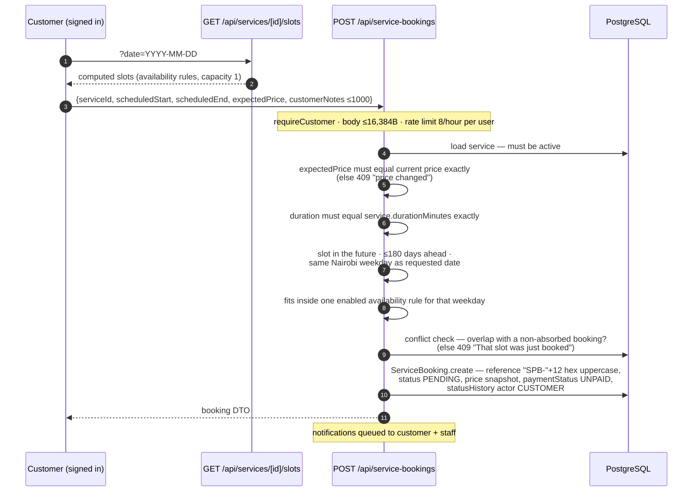
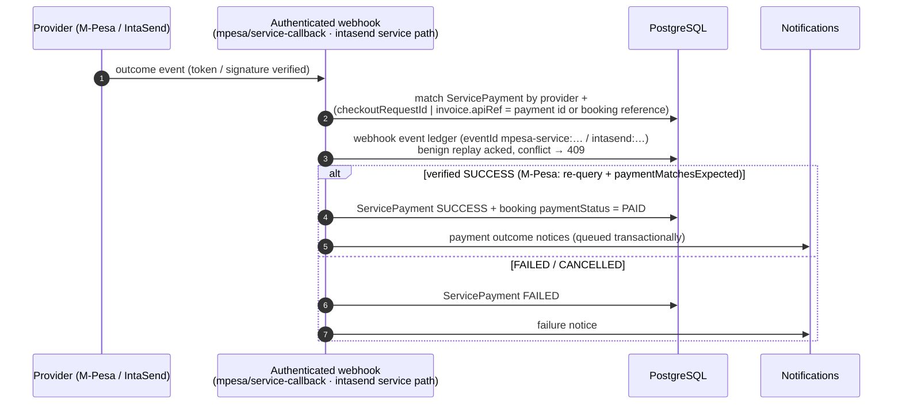

# Service Bookings Workflow

This document covers the clinical-services booking pipeline: the nine-status booking state machine staff drive from the admin console, slot computation from `ServiceAvailability` rules (Nairobi, UTC+3, capacity 1), customer-side creation with strict price/duration equality, the payment options (pay-at-pharmacy intent, card, M-Pesa), reminder crons, and post-completion reviews.

| Audience | Status | Verified |
| --- | --- | --- |
| Engineers, pharmacy operators, AI coding agents | Implemented — verified against code | November 2026 |

## 1. Booking status state machine

Statuses: `PENDING`, `CONFIRMED`, `RESCHEDULED`, `ARRIVED`, `IN_PROGRESS`, `COMPLETED`, `CANCELLED`, `NO_SHOW`, `REJECTED`. Active = `PENDING/CONFIRMED/RESCHEDULED/ARRIVED/IN_PROGRESS`; terminal = `COMPLETED/CANCELLED/NO_SHOW/REJECTED` (absorbing — empty transition lists, any further PATCH → 409). All transitions are staff actions via `PATCH /api/admin/service-bookings` (ADMIN/PHARMACIST/STAFF).

Exact transition map (`PENDING→[CONFIRMED, CANCELLED, REJECTED, RESCHEDULED]`, `CONFIRMED→[ARRIVED, CANCELLED, RESCHEDULED]`, `ARRIVED→[IN_PROGRESS, NO_SHOW]`, `IN_PROGRESS→[COMPLETED]`, `RESCHEDULED→[CONFIRMED, CANCELLED]`, terminal→`[]`); anything else → 409. Rescheduling uses the same PATCH with `scheduledStart`/`scheduledEnd` and is only valid from `PENDING`, `CONFIRMED`, or `RESCHEDULED` — it re-validates the slot from scratch (§3) and sets status `RESCHEDULED` + history + `SERVICE_BOOKING_RESCHEDULED` notification.

## 2. Slot computation

`GET /api/services/[id]/slots?date=YYYY-MM-DD` (public):

1. Load the service's enabled `ServiceAvailability` rules for that weekday (`dayOfWeek` 0–6, `startTime`/`endTime` "HH:MM", `enabled`; ≤35 rules, same-day non-overlap, `end > start`).
2. From each rule's start, step by the service's `durationMinutes` (default 15, range 5–480) while the whole appointment still fits before `endTime`.
3. Reject slots in the past and slots overlapping an existing booking **excluding** `CANCELLED`/`REJECTED`/`NO_SHOW`.
4. Capacity is strictly **1** per slot — one booking occupies a slot.
5. Time math is hard-coded **Nairobi UTC+3** (`Date.UTC(y, m, d, hour − 3, min)`); labels render via `toLocaleTimeString("en-KE", { timeZone: "Africa/Nairobi" })`.

### 2.1 Services and availability rules (upstream setup)

| Entity | Rules |
| --- | --- |
| Service CRUD | `GET /api/services` public active-only (`?includeInactive=true` staff); POST/PATCH staff (ADMIN/PHARMACIST/STAFF); slug auto-generated with a `-timestamp` suffix on collision; DELETE = soft deactivate. |
| Service fields | `durationMinutes` default 15 (range 5–480); `price` Decimal 0–10M — **null = free/price on application**; `heroImage` must be a managed image (`/images/...` or HTTPS `R2_PUBLIC_URL`); `featured`/`active`/`sortOrder` (−10,000…10,000); `ServiceImage` ≤ 10 managed URLs. |
| Availability rules | `ServiceAvailability`: `dayOfWeek` 0–6, `startTime`/`endTime` as "HH:MM", `enabled`; unique `[serviceId, dayOfWeek, startTime, endTime]`; ≤ 35 rules; same-day windows must not overlap; `end > start`. `PUT /api/services/[id]/availability` **replaces** the whole rule set (deleteMany + create enabled only). |
| Public reviews read model | `GET /api/services/[id]/reviews` → `{average (1 decimal), count, reviews[]}` with anonymized authors ("First L."). |

## 3. Booking creation

Validation summary:

| Rule | Failure |
| --- | --- |
| Service active | 409/404 |
| `expectedPrice` === current price (exact) | 409 "price changed" |
| Duration === `durationMinutes` (exact) | 409 |
| Future, ≤180 days ahead, one Nairobi day | 400 |
| Fits one enabled rule window | 400 |
| No overlapping live booking | 409 "That slot was just booked" |
| `customerNotes` ≤1000 | 400 |

## 4. Payments

Three options, all keyed to the booking (server keys `service:{id}:…`); amounts must match the booking price; `ServicePayment` rows mirror the order `Payment` discipline (unique idempotency/event ids, provider refs).

| Option | Flow | End state |
| --- | --- | --- |
| **Pay at pharmacy** | `POST /api/service-bookings/[id]/pay-at-pharmacy` (customer-owned; rejected if already `PAID`, status in `[CANCELLED, REJECTED, COMPLETED, NO_SHOW]`, or an online payment is `PENDING/PROCESSING/SUCCESS`; idempotent when already marked). Serializable tx sets `paymentStatus = "PAY_AT_PHARMACY"` + upserts `ServicePayment {provider IN_STORE, method PAY_AT_PHARMACY, PENDING, key service:{id}:pay-at-pharmacy}`; notices queued transactionally (dedupeKey `in-store:{id}`). | Intent marker only — **no settlement endpoint exists** (documented gap: recording cash taken at the counter requires a future cash-confirm analog). |
| **Card** | `POST …/pay/card` (8/15min per booking; `idempotencyKey` 16–100). Payable = not `PAID`, status ∉ `[CANCELLED, REJECTED, COMPLETED]`, price > 0, IntaSend configured. `reservePaymentAttempt` (booking in `PENDING/CONFIRMED/RESCHEDULED/ARRIVED/IN_PROGRESS`, amount match) → `ServicePayment INTASEND HOSTED_CHECKOUT PROCESSING`; hosted session `api_ref = payment.id`, redirect `/services?tab=bookings`; retry while `PROCESSING` with an `https` `providerReference` returns the cached checkout URL; uncertain provider response stays `PROCESSING` + 503. | IntaSend webhook service path (invoice `apiRef` = payment id or booking reference): `COMPLETE` → payment `SUCCESS` + booking `paymentStatus PAID`; `FAILED`/`CANCELLED` → `FAILED`. |
| **M-Pesa** | `POST …/pay/mpesa` (phone → `254[71]…`; 5/15min keyed `{bookingId}:{phone}`; whole-KSh amount; Daraja + `MPESA_CALLBACK_TOKEN` configured). Callback `/api/payments/mpesa/service-callback?token=…` (timingSafeEqual) matches `ServicePayment` by `(MPESA, CheckoutRequestID)`; `ResultCode 0` → re-query + `paymentMatchesExpected` → `SUCCESS` + booking `paymentStatus PAID` + notices; else `FAILED`. EventIds use the `mpesa-service:` prefix. | Callback-verified `PAID`. |

**Polling:** `GET /api/service-bookings/[id]/payment-status` — customer-only, read-only (40/10min), `private, no-store`; returns latest `ServicePayment.status` or the booking `paymentStatus`. No provider reconciliation happens here — only authenticated webhooks settle state. Full payment semantics: [payment-lifecycle.md](payment-lifecycle.md).

### 4.1 Online payment reconciliation (webhook path)

### 4.2 Reminder windows

| Lead time | Event | Dedupe key |
| --- | --- | --- |
| 23.5–24.5 h before `scheduledStart` | `SERVICE_BOOKING_REMINDER_24H` | `${event}:${bookingId}:${scheduledStart ISO}` |
| 1.5–2.5 h before `scheduledStart` | `SERVICE_BOOKING_REMINDER_2H` | same scheme |

Eligible statuses are `PENDING`/`CONFIRMED`/`RESCHEDULED`; a rescheduled booking is reminded at its **new** time (the ISO timestamp in the dedupe key changes, so the old reminder cannot suppress the new one). Reruns are idempotent; the job fail-fasts with 503 if any queue write fails.

## 5. Staff management

| Capability | Endpoint / rule |
| --- | --- |
| Status transitions | `PATCH /api/admin/service-bookings` — the §1 map; other transitions → 409; every change writes `ServiceBookingStatusHistory` + notifies (`notifyServiceBooking`). |
| Reschedule | Same PATCH with `scheduledStart`/`scheduledEnd`; only from `PENDING`/`CONFIRMED`/`RESCHEDULED`; re-validates future/duration/one-Nairobi-day/rule fit/overlap; sets `RESCHEDULED`. |
| Assignment | `PATCH /api/admin/service-bookings/[id]/assign` — `staffId` (null clears); target must be an active `ADMIN/PHARMACIST/STAFF`; notifies staff (`SERVICE_ASSIGNED`). Dropdown source: `GET /api/admin/service-staff`. |
| Admin list | `GET /api/admin/service-bookings` — scopes: `overview` (pendingCount, upcomingCount, pendingPreview 4, nextBooking on Nairobi day bounds `T00:00:00+03:00`), `manage` (queue/upcoming/history/all; status, date range today/next7/custom ≤366 d, staffId incl. unassigned, search ≤120 chars over reference/service/customer; page ≤100000, pageSize 5–50 default 20), `detail` (latest 100 status-history rows, descending). |
| Analytics | `GET /api/admin/service-analytics` (ADMIN): totals, completed, cancelled (`CANCELLED+REJECTED+NO_SHOW`), revenue (completed prices), completionRate, byService over a from/to window (default 30 d). |
| Reminders cron | `GET /api/cron/service-booking-reminders` (Bearer `CRON_SECRET` ≥32; run ≥ every 15 min): eligible bookings `PENDING/CONFIRMED/RESCHEDULED`; 24 h window (23.5–24.5 h ahead) → `SERVICE_BOOKING_REMINDER_24H`; 2 h window (1.5–2.5 h) → `SERVICE_BOOKING_REMINDER_2H`; rescheduled bookings are reminded at the **new** time. Stable dedupeKey `${event}:${bookingId}:${scheduledStart ISO}` makes reruns safe; **fail-fast 503** "Could not queue all reminders. Retry this job." on the first error; returns `{ok, queued}`. Scheduling is external — see [../operations/scheduled-jobs.md](../operations/scheduled-jobs.md). |

## 6. Reviews

`POST /api/service-bookings/[id]/review` — customer only:

- booking must be `COMPLETED`; `rating` 1–5; `comment` ≤1000;
- unique per `(bookingId, userId)` — one review per booking per customer;
- creates `ServiceReview {rating, comment, status PUBLISHED, staffId = assignedStaffId}` — the assignment is **snapshotted** at review time so later reassignment doesn't rewrite history;
- public aggregates at `GET /api/services/[id]/reviews`: `{average (1 decimal), count, reviews[]}` with anonymized authors ("First L.").

## 7. Failure cases and recovery

| Stage | Failure | System behavior | Recovery |
| --- | --- | --- | --- |
| Slot race | Two customers grab the same slot concurrently | Losing insert hits the overlap check → 409 **"That slot was just booked"**. | Customer picks another slot; UI refreshes availability. |
| Price change | Service price edited between page load and submit | 409 "price changed" (exact-match `expectedPrice`). | Customer re-confirms at the new price. |
| Duration drift | Service `durationMinutes` edited meanwhile | 409 on duration equality check. | Re-select a slot at the new duration. |
| Window mismatch | Slot outside rules / past / >180 d / cross-day | 400 validation error. | Choose a valid slot from the picker. |
| Double transition | Staff PATCH an invalid pair (incl. any terminal target) | 409; terminal statuses are absorbing. | No recovery needed — read the current status. |
| Reschedule conflict | New time overlaps or violates rules | 409; booking keeps its prior schedule. | Pick a free slot. |
| Pay-at-pharmacy | Customer marks intent, never shows | `PAY_AT_PHARMACY` `ServicePayment` stays `PENDING`; booking follows its status machine (`NO_SHOW`). No money settled online — nothing to refund. | Staff records the outcome via status; intent marker remains for reporting. |
| Card/M-Pesa | Provider timeout/uncertain response | `ServicePayment` stays `PROCESSING`; 503 to client. | Await webhook; do not force-reset (see [payment-lifecycle.md](payment-lifecycle.md)). |
| Payment webhook lost | Charge captured, webhook never arrives | **Known gap:** no reconciliation cron for `ServicePayment` either; polling endpoint is read-only. | Compare provider portal to DB; rectify manually. |
| Reminders cron | One reminder queue-write fails | Fail-fast 503; stable dedupeKeys mean a retry cannot double-send. | Re-invoke the job (external scheduler). |
| Review | Non-`COMPLETED` booking or duplicate review | 400/409. | Reviews open only after completion. |

## 8. Rate limits and guards

| Endpoint / action | Limit |
| --- | --- |
| `POST /api/service-bookings` | 8/hour per user, body ≤ 16,384 B |
| `POST …/pay/card` | 8/15min per booking |
| `POST …/pay/mpesa` | 5/15min keyed `{bookingId}:{phone}` |
| `GET …/payment-status` | 40/10min (customer-only, read-only) |
| `POST …/review` | one review per `(bookingId, userId)`, `COMPLETED` bookings only |
| `POST …/pay-at-pharmacy` | idempotent via `service:{id}:pay-at-pharmacy` key |
| Staff transitions / reschedule / assignment | ADMIN/PHARMACIST/STAFF session required |

## 9. Data model

| Model | Role |
| --- | --- |
| `Service` | `durationMinutes` (default 15), `price` (Decimal, null = free/POA), `active`, `featured`, `sortOrder`, slug uniqueness. |
| `ServiceAvailability` | per-weekday windows ("HH:MM"), `enabled`, unique `[serviceId, dayOfWeek, startTime, endTime]`. |
| `ServiceBooking` | `reference` (`SPB-` + 12 hex), `scheduledStart/scheduledEnd`, `status`, `price` snapshot, `paymentStatus` (`UNPAID`/`PAID`/`PAY_AT_PHARMACY`), `assignedStaffId`; overlap index `[serviceId, scheduledStart, scheduledEnd]` powers conflict checks. |
| `ServiceBookingStatusHistory` | every transition with actor + note. |
| `ServicePayment` | booking-scoped mirror of `Payment` (same uniqueness disciplines, no refund fields). |
| `ServiceReview` | rating + comment, unique `[bookingId, userId]`, `staffId` snapshot. |

## Related documentation

- [payment-lifecycle.md](payment-lifecycle.md) — shared payment semantics (§8 covers the service mirror).
- [order-lifecycle.md](order-lifecycle.md) — the parallel order state machine.
- [../features/services-and-bookings.md](../features/services-and-bookings.md) — customer + admin UI.
- [../api/api-reference.md](../api/api-reference.md) — endpoint reference.
- [../operations/scheduled-jobs.md](../operations/scheduled-jobs.md) — reminder cron cadence.
- [../database/data-lifecycle.md](../database/data-lifecycle.md) — schema.
- [../../README.md](../../README.md)
